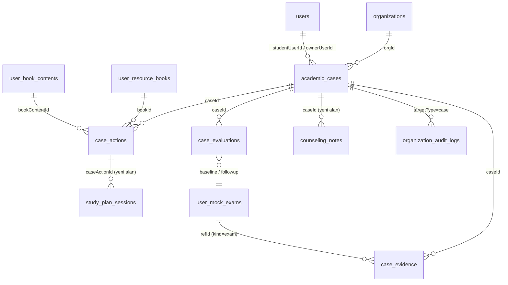

# Novara Akademik Aksiyon Döngüsü v5 — Denetim ve Uygulama Planı

**Tarih:** 22 Ekim 2026 · **İstem:** "Claude Uygulama Prompt — Novara Akademik Aksiyon Döngüsü v5"
**Karşılaştırılan önceki rapor:** `NOVARA_FAZ0_DENETIM.md` (Markdown asıl metin; HTML sayfa onun özeti).
**Durum:** Kod, veritabanı ve git değiştirilmedi; migration çalıştırılmadı. Onay bekliyor.

## Önce okunması gereken üç not

1. **İstemin ekindeki `Novara_Akademik_Aksiyon_Dongusu_v5.md` bulunamadı.** İndirilenler klasöründe yok. Oradaki benzer adlı iki dosya bu projeyle ilgisiz: `Faz 1 Sonuç Raporu.md` 27 Eylül tarihli, başka bir Laravel projesine (istasyon/personel) ait; `novara-yazilim-guncel.zip` ise 2 Ekim tarihli eski bir iskelet. Bu rapor istem metnine ve gerçek koda dayanır. Ek belge ayrı bir şey içeriyorsa gönderilince karşılaştırılmalı.
2. **GitHub'daki kod eski.** `origin/main` = `fe2fb15` (canlı sürüm, Railway MySQL). LGS, kurum ders programı, Duvarım, ortak kitap kaydı ve PostgreSQL geçişi yalnızca yerel `lgs-support` dalında, push edilmedi. Denetim bu dal üzerinde yapıldı; GitHub'a bakan biri bu özellikleri göremez.
3. **İstemdeki "Drizzle/MySQL" güncel değil.** Dal PostgreSQL (Supabase'e hazır). Migration kuralları aynı: yalnızca eklemeli, RLS açık.

---

## A) Kanıt tablosu — var olan / olmayan

Durum yalnızca **kod + test** ile doğrulandıysa ✅. Kod var ama testi yoksa 🟡. Tasarım önerileri bu tabloda yok (B–F'de).

| Yetenek | Dosya · fonksiyon | Test | Durum |
|---|---|---|---|
| Risk kuralları | `shared/org.ts:164` `RISK_RULES = { inactiveDays: 7, lowAdherence: 40, netDrop: 5 }`; `:190` `summarizeStudent()` — sınav türüne göre son iki deneme farkı (`lastByKind`) | `server/orgIsolation.test.ts:311-316` (inactive, low_adherence, net_drop) | ✅ — ama **yalnızca son iki deneme**, karşılaştırılabilirlik (yayınevi, kapsam, yıl) ve güven düzeyi yok |
| TYT/AYT/LGS ayrımı | `shared/exams.ts` `EXAM_KIND_DEFS`, `kindsOf()`; `summarizeStudent` her türü ayrı hesaplar | `server/exams.test.ts:40-88` | ✅ (ayrı tür = karışmaz). Yıl/soru kapsamı karşılaştırmada kullanılmıyor 🟡 |
| Deneme verisi | `drizzle/schema.ts:74` `user_mock_exams` (exam, examDate, net, subjectsJson, topicDetailsJson, importedFrom: manual/ocr/pdf/csv/xlsx) | `server/routers.ts` deneme içe aktarma testleri | ✅ öğrenci girişi. **Kurum kaynaklı sonuç yok** (yayınevi/deneme kodu alanı yok) |
| Öğrenci erişimi (kurum) | `server/org/orgAccess.ts:35` `assertCanViewStudent()`; `shared/org.ts:47` `seesAllStudents` (coordinator+ hepsini görür); `server/org/orgDb.ts:69` `teacherStudentIds()` (atanan + sorumlu olunan sınıf) | `orgIsolation.test.ts` 1, 2, 3, 5, 6; `orgTimetable.test.ts` (sorumlu öğretmen) | ✅ |
| Öğretmen görevi | `server/routers/org.ts` `tasks.assign` → `server/org/orgDb.ts:379` `insertAssignedTask()` → `study_plan_sessions.assignedByUserId/assignedOrgId` | `orgIsolation.test.ts:102, 169` | ✅ |
| Görev çakışma kontrolü | `tasks.assign` içinde `findClassConflict(getClassSchedule().blocks…)` (`shared/classSchedule.ts:164`) | `server/classSchedule.test.ts` (fonksiyon) | 🟡 **Eksik:** yalnızca öğrencinin kendi okul/dershane blokları. **Kurum ders programı** (`getCourseBlocks`) ve **öğrencinin diğer planlı görevleri** kontrol edilmiyor; uygun saat önerilmiyor |
| Görüşme notları | `counseling_notes` (visibility `staff`/`student`); `org.notes.create/remove`; `listStudentFeedback` | `orgIsolation.test.ts:157` (8) | ✅ — ama koordinatör/yönetici **tüm** notları görür; "mahrem not" kademesi yok |
| Denetim kaydı | `organization_audit_logs`, `audit()` (`orgAccess.ts:43`) | `orgIsolation.test.ts:166` (9) | ✅ |
| Öğrenci detay ekranı | `client/src/pages/org/StudentDetail.tsx` — sekme değil panel: Net gelişimi (:82), Zayıf konular (:85), Denemeler (:94), Konu durumu (:103), Görev ata (:112), Plan ve görevler (:123), Görüşme notları (:141) | e2e: kurum öğrencileri, sorumlu öğretmen | ✅ ekran. **Değişiklik noktası:** üst bilgi şeridi + "Takip dosyası" sekmesi/paneli |
| Elde olan kitaptan öneri | `server/bookContent/bookContentDb.ts` `getWeakTopicBookRecommendations()` → `bookStudyAllocation.ts` `buildBookRecommendations()` (öğrencinin **kendi** kitabının içindekilerinden, yapılmış/planlanmış sayfaları düşerek) | `server/bookContent.test.ts:164-169` | ✅ |
| Katalog önerisi | `server/resourceCatalog/recommendationService.ts:82` `recommendBooksForTopic`, `:144` `recommendForStudent`; `server/routers/resourceCatalog.ts:51` `recommendations` | `recommendationService.test.ts` | ✅ — ama **sahip olunan kitabı dikkate almıyor** (katalogdan, yani satın alınacak kitap önerir). İki öneri yolu birleşik değil |
| Kitap kayıtları | `user_resource_books`, `book_inventory`, `book_study_logs`, `book_topic_mappings`, `user_book_contents` (topicId'li), `shared_books` | `bookContent*.test.ts`, `sharedBooks.test.ts` | ✅ |
| Soru/konu kanıtı | `notebook_questions` + `question_attempts` (topicId'li); `topic_study_logs` (**konu metin**, topicId yok); `topic_progress` | `questionNotebook.test.ts`, `topicLogRow.test.ts` | 🟡 çalışma kayıtlarında konu kimliği yok |
| Müdahale / vaka | — | — | ❌ yok (vaka, kanıt, eylem, değerlendirme tabloları yok) |
| Öğrencinin görev geri bildirimi | `study_plan_sessions.status` (planned/completed/skipped) + süre/soru/D-Y-B | `planAdherence.test.ts` | 🟡 "Tamamladım" var; **"Zorlandım / Tekrar etmeliyim"** yok |
| Veli erişimi | `parent_links`, `server/routers/parent.ts` `student` (notlar/defter kapalı) | `server/parentAccess.test.ts` | ✅ |
| Kurum veri aktarımı | — | — | ❌ (Connect yok) |

---

## B) En küçük MVP — bir kurum, bir sınıf, bir öğrenci, bir öğretmen, bir döngü

**Seçilen yol (istem: "çalışan kod ve güvenilir veri olan yol"):** **YKS-TYT**, öğrencinin girdiği denemelerle. Gerekçe: TYT'nin deneme şablonu, ders kırılımı, konu eşleşmesi ve testleri en olgun; LGS de çalışıyor ama kitap içerik verisi daha az. Kurum aktarımı (Connect) gelene kadar güven düzeyi en fazla **"orta"** gösterilir ve bu ekranda yazar.

**Senaryo (seed verisiyle uçtan uca):** Kurum "Örnek Dershane", sınıf 12-A Sayısal, öğrenci 024, sorumlu öğretmen Kenan Hoca (seed'de `ogretmen3`, 12-A sorumlusu).

1. **Tespit:** 024'ün TYT denemeleri 82 → 76 → 69 (öğrenci girişi, aynı tür, 75 gün içinde). Kural `trend_decline` tetiklenir, güven **orta**. Ekranda "Akademik inceleme önerisi" — teşhis değil.
2. **Takip dosyası açılır** (öğretmen ya da sistem önerisini kabul ederek). Kanıt: üç deneme, ders kırılımı (ör. Matematik 28 → 25 → 21), son 4 hafta çalışma süresi, zayıf konular, kitap ilerlemesi — **anlık görüntü** olarak saklanır.
3. **Kaynak360 "Eldeki kitaplardan öner":** zayıf konu (ör. Problemler) için öğrencinin rafındaki kitabın içindekilerinden ilgili test/sayfa (`buildBookRecommendations`). Eldeki kitapta yoksa: "Rafında bu konu için kaynak bulunamadı" + katalogdan **en fazla 3** öneri, açıkça "yeni kaynak" etiketiyle (satın alma baskısı yok).
4. **Pusula "Çalışma planı önizlemesi":** 3 gün × 40 dk; her görev öğrencinin okul/dershane saatleri, kurum ders programı ve mevcut görevleriyle çakışmayan ilk uygun saate yerleşir. **Yer yoksa görev yazılmaz**, önizlemede "Bu gün uygun saat yok" görünür. Öğretmen onaylar → görevler takvime düşer.
5. **Öğrenci "Bu haftaki çalışmalar":** her görevde **Tamamladım / Zorlandım / Tekrar etmeliyim** (+ isteğe bağlı soru/D-Y-B).
6. **Rehber "Sonucu değerlendir":** sonraki karşılaştırılabilir TYT denemesi geldiyse fark (ör. 69 → 74) + görev tamamlama (3/3) + öğrenci geri bildirimi. Deneme yoksa **sınırlı gösterge**: görev tamamlama, ilgili konuda çözülen soru doğruluğu, öğrencinin "zorlandım" işaretleri — ve "Karşılaştırılabilir yeni deneme yok; değerlendirme sınırlıdır" uyarısı. Öğretmen **Tamamlandı / Devam ediyor / Yeniden değerlendir** seçer. Kapatılan dosya yeniden açılabilir.

**MVP dışı:** Connect, yönetici özetinde grafik, veli görünümü, AI özet, LGS özel karşılaştırma ayarları.

---

## C) ER diyagramı, migration taslağı ve veri koruma



**Yeni tablolar (hepsi `orgId` taşır, RLS açık):**

| Tablo | Alanlar | Kısıt / indeks |
|---|---|---|
| `academic_cases` | id, orgId, studentUserId, ownerUserId, examKind (null olabilir), ruleKey (`trend_decline`, `inactive`, `low_adherence`, `manual`…), comparabilityKey, confidence (`low/medium/high`), status (`open/in_progress/evaluating/closed`), outcome (`completed/ongoing/reassess`), openedBy (`system`/userId), openedAt, closedAt, reopenedFromId | **kısmi UNIQUE** `(orgId, studentUserId, ruleKey, comparabilityKey) WHERE status <> 'closed'` → aynı risk ikinci kez açık dosya üretmez; indeks `(orgId, status)`, `(orgId, ownerUserId, status)` |
| `case_evidence` | id, caseId, orgId, kind (`exam/study/topic/book/question`), refTable, refId, snapshotJson, capturedAt | indeks `(caseId)`; anlık görüntü sonradan değişmez |
| `case_actions` | id, caseId, orgId, type (`review/meeting/resource/plan/note`), payloadJson, bookId, bookContentId, status (`planned/done/cancelled`), createdBy, **idempotencyKey** | **UNIQUE `(caseId, idempotencyKey)`** → çift tıklama/tekrar gönderim ikinci görev üretmez |
| `case_evaluations` | id, caseId, orgId, baselineExamId, followupExamId (null = yeni deneme yok), netChange, tasksDone, tasksTotal, studentSignalsJson (tamamladım/zorlandım/tekrar sayıları), limitedEvidence (bool), uncertaintyNote, teacherOutcome, evaluatedBy, evaluatedAt | indeks `(caseId)` |

**Mevcut tablolara eklemeli alanlar (hepsi boş bırakılabilir):**
- `study_plan_sessions.caseActionId` (int), `.studentFeedback` (`done/struggled/needs_review`), `.studentFeedbackAt`
- `counseling_notes.caseId` (int); `counseling_notes.visibility` += `owner_only` (yalnızca yazan + öğrencinin sorumlu öğretmenleri)
- `user_mock_exams.publisher`, `.examCode`, `.scope` (`full/branch`) — karşılaştırılabilirlik için; boşsa güven düşer

**Migration:** tek ekleme migration'ı (yayınlanmamış `0002`'ye katlanır ya da `0003_academic_cases`). Var olan satır değişmez; varsayılanlar mevcut davranışı korur (`visibility` mevcut değerleri aynen kalır).

**Veri koruma:**
- Takip dosyası öğrencinin **kurumdaki** kaydıdır: öğrenci kurumdan ayrılınca kurum dosyaları görmez (mevcut `isActiveStudent` kuralı); öğrencinin kendi verisi (`userId`) silinmez.
- Duvar, defter, Niyet Kavanozu hiçbir kanıt sorgusuna girmez (kanıt türleri sabit liste).
- `owner_only` notlar yönetici ve veliye kapalı; yöneticinin "Akademik takip özeti" yalnızca sayılar ve durum içerir.
- Tüm eylemler `organization_audit_logs`'a (`case.open`, `case.action`, `case.evaluate`, `case.close`, `case.reopen`).

---

## D) API sözleşmeleri (tRPC + Zod)

Tümü `org` router'ı altında `cases` alt router'ı; her uç `orgProcedure(rol)` + `assertCanViewStudent` + audit.

```ts
const id = z.number().int().positive();
const examKind = z.enum(EXAM_KINDS);

cases.queue      // orgProcedure("teacher")
  .input(z.object({ status: z.enum(["open","in_progress","evaluating","closed"]).optional(), ownerOnly: z.boolean().default(true) }))
  // → [{ caseId, student: { userId, name, className }, ruleKey, confidence, openedAt, lastActionAt, dueAt }]

cases.signals    // orgProcedure("teacher") — dosyası olmayan öneriler
  .input(z.object({}).optional())
  // → [{ studentUserId, ruleKey, examKind, confidence, evidencePreview, insufficient: boolean }]

cases.open       // orgProcedure("teacher")
  .input(z.object({ studentUserId: id, ruleKey: z.enum(["trend_decline","inactive","low_adherence","manual"]), examKind: examKind.nullable(), note: z.string().max(2000).optional() }))
  // → { caseId, created: boolean }   (açık dosya varsa created=false, aynı caseId)

cases.get        // orgProcedure("teacher")
  .input(z.object({ caseId: id }))
  // → { case, evidence[], actions[], evaluations[], notes[] (görünürlüğe göre süzülmüş) }

cases.suggestResources   // orgProcedure("teacher")
  .input(z.object({ caseId: id, topicIds: z.array(id).max(10) }))
  // → { owned: [{ bookId, title, items: [{ bookContentId, label, pageStart, pageEnd }] }], missingTopicIds: number[], catalog: [{ catalogBookId, title, reason }] (≤3, yalnızca owned boşsa) }

cases.previewPlan        // orgProcedure("teacher")
  .input(z.object({ caseId: id, items: z.array(z.object({ subject: z.string().max(80), topicId: id.nullable(), topic: z.string().max(180), minutes: z.number().int().min(10).max(180), targetQuestions: z.number().int().min(0).max(200).optional(), bookId: z.string().max(120).optional(), bookContentId: id.optional() })).min(1).max(14), from: z.string().date(), days: z.number().int().min(1).max(14) }))
  // → { placements: [{ itemIndex, date, start, end } | { itemIndex, date, conflict: "no_slot", reason }] }

cases.assignPlan         // orgProcedure("teacher")
  .input(previewInput.extend({ idempotencyKey: z.string().uuid() }))
  // → { actionId, sessionIds: number[], skipped: [{ itemIndex, reason }] }   (çakışan saat ASLA yazılmaz)

cases.evaluate           // orgProcedure("teacher")
  .input(z.object({ caseId: id, outcome: z.enum(["completed","ongoing","reassess"]), note: z.string().max(2000).optional() }))
  // → { evaluationId, limitedEvidence: boolean }

cases.reopen             // orgProcedure("teacher")
  .input(z.object({ caseId: id, reason: z.string().min(3).max(500) }))

cases.adminSummary       // orgProcedure("admin")
  // → { open, inProgress, evaluating, closedLast30, overdue, byClass: [...] }   (not içeriği yok)

// Öğrenci tarafı (protectedProcedure; yalnızca kendi görevleri; dosyanın kendisi görünmez)
studyTasks.thisWeek      // → [{ sessionId, title, subject, topic, date, minutes, assignedBy, feedback }]
studyTasks.feedback      .input(z.object({ sessionId: id, feedback: z.enum(["done","struggled","needs_review"]), minutes: z.number().int().min(0).max(600).optional(), questions: z.number().int().min(0).max(500).optional(), correct: z.number().int().min(0).optional(), wrong: z.number().int().min(0).optional() }))
```

---

## E) Metinsel wireframe'ler

**Öğrenci — "Bu haftaki çalışmalar"** (Pusula Genel Bakış'ta kart + Takvim'de etiket)
```
┌ Bu haftaki çalışmalar ───────────────── 2/3 ┐
│ Kenan Hoca'nın önerisi                       │
│ ● Sal 17:20  Problemler · 40 dk              │
│   Karekök Problemler — Test 4–5 (s. 41–48)   │
│   [Tamamladım] [Zorlandım] [Tekrar etmeliyim]│
│ ✓ Pzt 18:10  Problemler · 40 dk · Tamamladım │
└──────────────────────────────────────────────┘
```
"Neden?" bağlantısı öğretmenin öğrenciye görünür notunu gösterir; risk dili yok.

**Öğretmen — "Takip dosyası"** (Kurum Paneli → Öğrenci detayı)
```
Öğrenci 024 · 12-A Sayısal · TYT · Sorumlu: Kenan Hoca · Son deneme 69 (12 Eki) · Son etkinlik dün
Durum: [ İnceleniyor ]   Güven: orta (öğrenci girişi)
─ Kanıt ────────────────────────────────────────
 Net: 82 → 76 → 69   Mat 28→25→21  Fen 16→15→14
 Çalışma: 6s 20dk → 4s 10dk (son 4 hafta)   Zayıf: Problemler, Kuvvet
─ Eldeki kitaplardan öner ──────────────────────
 ✓ Karekök Problemler: Test 4–5 (s. 41–48)   [Plana ekle]
 ✗ Kuvvet: rafta kaynak yok · katalogdan 3 öneri (yeni kaynak)
─ Plan önizlemesi ──────────────────────────────
 Sal 17:20–18:00 ✓   Çar — uygun saat yok   Per 19:00–19:40 ✓
 [Planı öğrenciye gönder]
─ Zaman çizelgesi ──────────────────────────────
 12 Eki öneri oluştu · 13 Eki dosya açıldı · 14 Eki plan gönderildi
─ [Sonucu değerlendir] [Not ekle (yalnızca ben)] [Dosyayı kapat]
```

**Yönetici — "Akademik takip özeti"**
```
Açık 7 · Devam eden 4 · Değerlendirmede 2 · Son 30 günde kapanan 9 · Geciken 1
Sınıf      Açık  Geciken  Ort. süre
12-A Say.   3      1       9 gün
12-B EA     2      0       6 gün
(Not içerikleri bu ekranda görünmez.)
```

---

## F) Dosya bazlı görevler ve teslim kapıları

**G0 — Kurallar (DB ve ekran yok)**
- 🆕 `shared/academicCase.ts`: `comparabilityKey()`, `trendDecline()` (her adım ≤ 0, toplam ≥ eşik; YKS 5, LGS 3), `confidenceOf()`, `insufficientReason()`, öneri metni şablonu
- `shared/org.ts`: `summarizeStudent` yeni kurala bağlanır, mevcut rozetler aynı kalır
- 🆕 `shared/planPlacement.ts`: `findSlots(blocks, courseBlocks, plannedSessions, items, from, days)` → yerleşim ya da `no_slot`
- 🆕 `server/academicCase.test.ts` (saf testler)
- **Kapı G0:** 82/76/69 tetikler; 82/85/69 tetiklemez; TYT+LGS karışmaz; 2 deneme → yetersiz; çakışma → `no_slot`. Mevcut 658 test geçer.

**G1 — Şema + sunucu**
- `drizzle/schema.ts` + migration (C bölümü), RLS satırları
- 🆕 `server/org/caseDb.ts` (aç/idempotent, kanıt anlık görüntüsü, eylem, değerlendirme, yeniden açma)
- 🆕 `server/routers/orgCases.ts` → `server/routers/org.ts`'e `cases`
- `server/org/orgAccess.ts`: `owner_only` not süzgeci; `tasks.assign` çakışma kontrolüne kurum programı + planlı görevler (mevcut hatanın düzeltilmesi)
- `server/bookContent/bookContentDb.ts`: `suggestOwnedResources(userId, topicIds)` (mevcut `buildBookRecommendations` üzerine)
- 🆕 `server/studyTasks.ts` + router (öğrenci geri bildirimi)
- **Kapı G1:** izolasyon, rol, tekrar risk, çift görev, gizli not, veli testleri geçer.

**G2 — Ekranlar**
- `client/src/pages/org/StudentDetail.tsx`: üst bilgi şeridi + "Takip dosyası" paneli
- 🆕 `client/src/pages/org/CaseFile.tsx`, `CaseResourcePicker.tsx`, `CasePlanPreview.tsx`
- 🆕 `client/src/pages/org/OrgCases.tsx` (kuyruk + öneriler) ve `OrgApp.tsx`/`orgShared.tsx` menüsü
- 🆕 `client/src/components/app/ThisWeekTasks.tsx` (öğrenci), `client/src/pages/overview/Overview.tsx`'e kart
- **Kapı G2:** e2e: öneri → dosya → kaynak → plan → öğrenci geri bildirimi; 390 px'te taşma yok.

**G3 — Değerlendirme ve özet**
- `caseDb.evaluate/close/reopen`, sınırlı kanıt göstergesi
- 🆕 yönetici özeti ekranı (`OrgDashboard.tsx` kartları)
- `server/digest/teacherDigest.ts`: "yeni inceleme önerisi" satırı
- `scripts/seed-test-org.ts`: 024 senaryosu
- **Kapı G3:** başarılı kapanış + yeniden açma e2e; pilot kontrol listesi.

---

## G) Test matrisi, kabul kriterleri, geri alma

| # | Test | Tür | Kabul kriteri |
|---|---|---|---|
| 1 | Ayrı kurum erişimi | DB | B kurumunun öğretmeni A'nın dosyasını/öğrencisini **404** ile göremez |
| 2 | Yanlış rol | Router | Öğrenci `cases.*` çağıramaz; öğretmen `adminSummary` çağıramaz |
| 3 | Atanmamış öğretmen | DB | Sorumlu/atanmış olmayan öğretmen dosyayı göremez |
| 4 | Aynı riskin tekrarı | DB | Aynı sinyal ikinci kez → yeni dosya yok, `created=false` |
| 5 | Çift görev | DB | Aynı `idempotencyKey` → tek eylem, tek görev seti |
| 6 | Plan çakışması | Saf + DB | Okul bloğu, kurum programı ya da mevcut görevle çakışan saate görev **yazılmaz**; `no_slot` döner |
| 7 | Kaynak bulunmaması | DB | Rafta konu yoksa `missingTopicIds` dolu, katalog önerisi ≤ 3 ve "yeni kaynak" etiketli |
| 8 | TYT–LGS karışmaması | Saf | Karışık türlerde `trendDecline` tetiklenmez |
| 9 | Yetersiz veri | Saf | 2 deneme ya da farklı yayınevi → öneri yok, "inceleme için yetersiz" |
| 10 | Gizli not sızıntısı | DB | `owner_only` not yönetici, veli ve diğer öğretmene dönmez |
| 11 | Veli yetkisi | DB | Veli dosyayı ve notları göremez; yalnızca mevcut özet |
| 12 | Başarılı kapanış | e2e | Değerlendirme → `closed/completed`; denetim kaydı var |
| 13 | Yeniden açma | DB | Kapalı dosya gerekçeyle yeniden açılır; geçmiş korunur |
| 14 | Yeni deneme yok | DB | Değerlendirme `limitedEvidence=true` ve belirsizlik notu |
| 15 | Regresyon | Tümü | Mevcut 658 birim + 22 e2e geçer |

**Geri alma ve riskler:**
- Migration yalnızca ekleme: yeni tabloları ve boş alanları geri almak `DROP TABLE` / `DROP COLUMN` (veri kaybı yalnızca yeni özellikte).
- Özellik kurum bazında kapatılabilir (öneri: `organizations.featuresJson.academicCases`, varsayılan kapalı; pilot kurumda açılır).
- `tasks.assign` çakışma düzeltmesi **mevcut davranışı değiştirir** (bugün kabul edilen bazı görevler reddedilir) → hata mesajı uygun saat önerir.
- Not görünürlüğü `owner_only` yalnızca yeni notlarda; eski notlar `staff` kalır (geriye uyumlu).
- Supabase'e geçişte veri sıfırlanacağı için canlı veri göçü riski yok; geçiş öncesi canlıya çıkmaz.

---

## H) AI kullanımı ve ölçülmesi gereken olaylar

**AI'sız (kural ve hesap):** risk tespiti, güven, karşılaştırma, kaynak eşleme, plan yerleşimi, değerlendirme sayıları, yönetici özeti.

**AI (isteğe bağlı, kotalı, öğretmen düzenler):**
1. Takip dosyası için **kanıt özeti** taslağı (sayılardan 3–4 cümle).
2. Öğrenciye görünecek **nazik açıklama** taslağı ("Bu hafta Problemler'e odaklanıyoruz çünkü…").
3. Değerlendirme notu taslağı.
Tanı, kesin başarı tahmini ve otomatik karar yok; AI kapalıyken her şey çalışır.

**Ölçülecek olaylar** (mevcut `feature_usage_logs`'a alan eklenerek):
| Olay | Alanlar | Neden |
|---|---|---|
| `case_ai_summary_requested` | orgId, caseId, model, inputTokens, outputTokens, latencyMs, cacheHit | Maliyet ve hız |
| `case_ai_summary_edited` | editDistanceRatio, accepted (bool) | Taslak ne kadar işe yarıyor |
| `case_opened` / `case_closed` | ruleKey, confidence, openedBy, duration | AI'dan bağımsız hacim; maliyet tahmininin tabanı |
| `case_signal_dismissed` | ruleKey, confidence | Yanlış alarm oranı |
| `plan_slot_unavailable` | gün, neden | Plan motorunun yetersiz kaldığı yer |

**Maliyet tahmini formülü:** aylık maliyet ≈ (aylık açılan dosya × dosya başına AI isteği) × (ortalama girdi + çıktı token) × model birim fiyatı. Birim fiyat ve ortalama token pilotta ölçülmeden sayı verilmemeli; önerim pilotun ilk iki haftasında yukarıdaki olayları toplayıp tahmini o veriyle yapmak. Kurum kredisi (`organization_credit_usage`) faturalamayı zaten destekliyor.

---

## Faz 0 raporuyla farklar

| Konu | Faz 0 | v5 (bu belge) |
|---|---|---|
| Vaka modeli | `guidance_cases` + `guidance_events` + `guidance_meetings` | `academic_cases` + `case_evidence` + `case_actions` + `case_evaluations` (istemin istediği kanıt/eylem/değerlendirme ayrımı); görüşme bir eylem türü |
| Kaynak | Kaynak360 ayrı faz | Döngünün içinde: "eldeki kitaplardan öner" MVP'de |
| Plan | Mevcut görev atama | Plan önizlemesi + **çakışma düzeltmesi** (bulunan hata) |
| Öğrenci | Görev tamamlama | Tamamladım / Zorlandım / Tekrar etmeliyim |
| Değerlendirme | Sonraki deneme | + yeni deneme yoksa sınırlı gösterge ve belirsizlik notu |
| Sıra | Rehber → Connect | Aynı; MVP öğrenci girişli TYT verisiyle, güven "orta" |

## Kararlar (22.10.2026)

1. ✅ MVP **TYT + öğrenci girişli deneme** ile başlar (güven "orta" gösterilir).
2. ✅ `tasks.assign` çakışma kontrolü düzeltildi (G0 ile birlikte): kurum ders programı ve öğrencinin o günkü planlı oturumları da dolu sayılır; çakışmada aynı gün uygun ilk saat önerilir, yoksa "Bu gün uygun saat yok".
3. ✅ **Öğretmen–öğrenci yazışmaları mahremdir:** yalnızca yazışmanın tarafları (öğrenci ve onun sorumlu öğretmeni) görür; koordinatör/yönetici ve veli görmez. G1'de `counseling_notes` görünürlüğü ve takip dosyası notları bu kuralla uygulanır (bugün koordinatör+ tüm notları görüyor; bu davranış değişecek).
4. ✅ Özellik kurum bazında açılır; pilotta tek kurum.
5. ⏳ Eksik ek belge (`Novara_Akademik_Aksiyon_Dongusu_v5.md`) gelirse karşılaştırılacak.

**G3 tamamlandı:** öğretmen haftalık özetine akademik takip bölümü (yeni inceleme önerileri, açık ve 7 günden uzun işlemsiz dosya sayısı; kapalı kurumda yok), öğretmen görev verince öğrenciye bildirim (zil + varsa telefon; dosya/risk dili yok), pilot kontrol listesi `NOVARA_PILOT_KONTROL_LISTESI.md`. Açık konu: sunucu saat dilimi (Vercel UTC) — kontrol listesi madde 1.3.

**G2 tamamlandı (7d0c50e):** Akademik takip sayfası, öğrenci detayında Takip dosyası, Ayarlar anahtarı, öğrencide "Bu haftaki çalışmalar".

**G1 tamamlandı (7fad9e1):** şema (`academic_cases`, `case_evidence`, `case_actions`, `case_evaluations` + eklemeli alanlar; RLS), `server/org/caseDb.ts`, `server/routers/orgCases.ts` (`org.cases.*`, öğrenci `studyTasks.*`), mahrem not kuralı (`org.student` notları ve not silme), `server/academicCases.test.ts` (8 veritabanı testi). Sıradaki: G2 ekranlar.

**G0 tamamlandı:** `shared/academicCase.ts` (karşılaştırılabilirlik, düşüş eğilimi, güven, yetersiz veri gerekçeleri, öneri metni), `shared/planPlacement.ts` (dolu saatler, çakışma, uygun saat, plan önizleme yerleşimi), `server/academicCase.test.ts` (11 test), `orgIsolation.test.ts` 10. senaryo (görev çakışması). `summarizeStudent` rozetleri G0'da değiştirilmedi; yeni kural G1'de takip dosyası açılırken kullanılacak.
